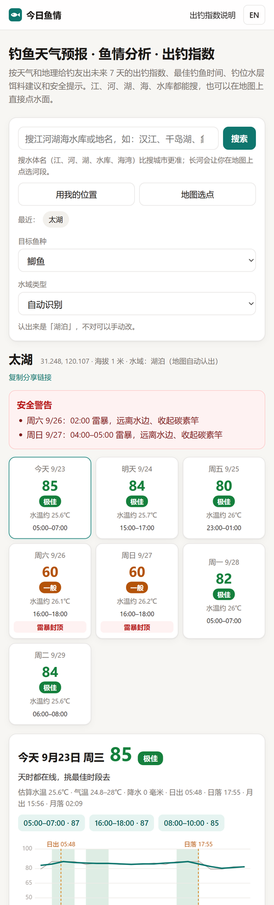
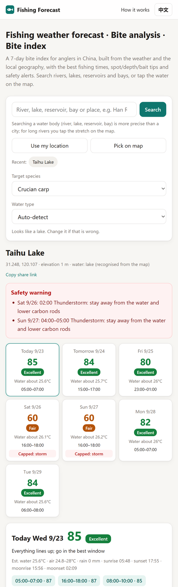

# 钓鱼天气预报 · 今日鱼情（网页 + 安卓 APK）

> 江河湖海水库，在地图上选中一片水，就能看到未来 7 天的出钓评分、每天最佳钓鱼时间、钓位和饵料建议。野钓、路亚、海钓都能用，免费、不用注册。
>
> **当前网页为鹰潭专用模式**：固定信江（鹰潭段），无地图选点，城市固定鹰潭市；鲫鱼、鳊鱼、翘嘴、鳜鱼 4 种目标鱼固定全选，每天给主钓 + 备选排行，默认台钓粉饵/虾建议。

- **在线使用**：<https://fish.satloot.com>（英文版 <https://fish.satloot.com/en/>）
- **安卓 APK 下载**：[Releases 页面](https://github.com/q3579338/fishing-weather-forecast-china/releases/latest)（文件名 `fishing-weather-forecast-v1.0.0.apk`）

<p>
  
  
</p>

## 功能

- **固定钓点（鹰潭）**：当前按信江（鹰潭段）出预报，无地图选点；4 种目标鱼固定参与排序，可切换水域类型。
- **7 天出钓评分**：每天一个 0–100 的分数和等级（极佳 / 好 / 一般 / 偏差 / 不建议），还有估算水温。
- **日期天气带**：点某天，详情顶部显示鹰潭当天的天气现象、最高/最低温、风、降水概率和湿度；切日期联动。
- **最佳钓鱼时间**：每天挑出最多 3 个时段，曲线上能看每个小时的分数。
- **八项打分说明**：水温、气压、温变、风、天空、时段、月相 / 潮汐、水域，每一项都用一句大白话告诉你为什么。
- **钓位与饵料建议**：按风向、水温、季节给出钓哪边、钓深钓浅、用什么饵。
- **安全提醒**：雷暴、大风、大浪会单独提示，当天分数也会被压低。
- **多鱼种主钓**：鲫鱼、鳊鱼、翘嘴、鳜鱼固定全选；7 天卡片显示当天最高分鱼种，详情按 v0.7 鱼种鱼情给主钓 + 备选排行，点排行可切换查看；台钓粉饵建议，可加虾粉/虾肉，翘嘴/鳜鱼用虾饵优先。
- **分享**：一键复制带位置的链接发给钓友（App 里直接调起系统分享）。
- **整页截图**：用本地 html2canvas 生成宽 1080 的整页长图（含 7 天、详情、说明），手机调系统分享，桌面下载 PNG；图片不上传。
- **中英双语**：页面右上角切换；App 按手机系统语言自动选择。

## 鱼情评分怎么算

完整口径见 [docs/model.md](docs/model.md)（网页 JS 与另一个 Python 版本共用同一份公式，改公式先改这个文件）。v0.4 在 v0.3 基础上增加：`surface_pressure` 海拔修正、Flood API 径流趋势、海钓潮差/流速/浪周期、低氧风险提示和季节/产卵建议；v0.5 把水域类型改为“上下文权重”；v0.6 是影子版（气压拆分、水温趋势、时段权重提高、solunar 降权）；**v0.7 是当前线上模型**：鱼种权重 + 时段/水域偏好 + 季节/溶氧修正，四目标鱼先用经验权重，未用鱼获校准。v0.5 只保留在详情做对比，v0.6 不再展示。简单说：

1. **小时分**：每个小时按八项打分再加权求和，权重是 水温 25、气压 20、温变 15、风 10、天空 10、时段 10、月相 / 潮汐 5、水域 5。水温按所选鱼种的适宜区间打分；气压看高低和 24 小时变化（急升急降都扣分）；早晚晨昏时段加分。
2. **水温闸门与危险封顶**：水温远离鱼种能活动的范围时整体打折；雷暴、大风、大浪的小时直接封顶。
3. **日分** = 0.6 × 当天最好 6 小时的均值 + 0.4 × 全天参与小时的均值；当天有雷暴或 7 级以上阵风，日分最高只给 60（严重时 45）。
4. **最佳时段**：在平滑后的小时分上挑最高点，前后各 1 小时为一段，最多 3 段。

这是按天气和经验估算的模型，**没有用真实鱼获数据校准**。

## 数据来源与致谢

| 项目 | 用途 | 许可 |
|---|---|---|
| [Open-Meteo](https://open-meteo.com/) | 天气（含 `surface_pressure`）、海况/潮位/海流/浪周期、河道径流（Flood API）；浏览器直连，免 key | 数据 CC BY 4.0 |
| 国家地表水水质自动监测实时数据发布系统 | 鹰潭市城市平均溶解氧（`tools/fetch-oxygen.mjs` 定时抓取，页面读同源 JSON） | 公共数据，按原站条款使用 |
| [OpenStreetMap](https://www.openstreetmap.org/copyright)（Overpass） | 自动识别水域类型 | ODbL |
| [SunCalc](https://github.com/mourner/suncalc) | 日出日落、月相、月出月落（内联于 `web/engine.js`） | BSD-2-Clause |
| [html2canvas](https://html2canvas.hertzen.com/) | 浏览器整页截图（本地 `web/vendor/html2canvas.min.js`） | MIT |

感谢以上项目和 OpenStreetMap 全体贡献者。

## 目录结构

```
web/            网页源码：index.html（中文，唯一源）、app.js（界面）、engine.js（鱼情引擎）、rank.js（多鱼种排行）、weather.js（日期天气汇总）、coord.js（高德坐标换算）、assets/、data/oxygen.json（城市平均溶解氧）
i18n/en.json    英文词典，构建时整句替换生成英文页
tools/          build.mjs（构建 site/）、test-engine.mjs（引擎回归）、test-rank.mjs（多鱼种排行）、test-weather.mjs（日期天气汇总）、fetch-oxygen.mjs（鹰潭城市平均溶解氧）、check-fixtures.mjs（与 Python 版对分）、test-coord.mjs、make-og.mjs
android/        安卓 App：原生 WebView 壳，把 site/ 打包进 APK
docs/           model.md（评分口径）、impl-notes.md（实现细节）、测试用例/、截图
fixtures/       Python 基准对分样例说明（见 fixtures/README.md）
CLAUDE.md       项目约定与构建/验证命令
.claude/        开发/验证规则与 /acceptance 命令
serve-dev.mjs   本地预览服务器
```

## 本地构建

### 网页

需要 Node.js 18+，没有任何 npm 依赖。

```bash
node tools/build.mjs      # 生成 site/（中文 / 和英文 /en/）
node serve-dev.mjs        # 打开 http://127.0.0.1:8791 预览
node tools/fetch-oxygen.mjs --out web/data/oxygen.json # 更新鹰潭城市平均溶解氧（建议 30–60 分钟一次）
node tools/test-engine.mjs # 引擎回归（合成 Open-Meteo 数据）
node tools/test-rank.mjs # 多鱼种排行纯函数
node tools/test-weather.mjs # 日期天气汇总纯函数
node tools/test-coord.mjs # 坐标换算自测
node tools/check-fixtures.mjs # 与 Python 基准对分（需要 fixtures/ 样例）
```

`site/` 是纯静态文件，放到任意静态托管即可。

### 安卓 APK

需要 JDK 17+、Android SDK（platform 35、build-tools 35）、Node.js。首次构建会下载 Gradle 8.2.1 和 Android Gradle 插件。

```bash
cd android
./gradlew assembleRelease     # Windows 用 gradlew.bat assembleRelease
# 产物：android/app/build/outputs/apk/release/app-release.apk
```

- 构建前会自动运行 `node tools/build.mjs`，再把最新的 `site/` 拷进 APK（加 `-PskipWebBuild` 可跳过网页构建，直接用现成的 `site/`）。
- App 用 `WebViewAssetLoader` 以 `https://appassets.androidplatform.net/` 加载本地页面：没网也能打开界面，天气和地图仍需联网。
- 定位权限只在点「用我的位置」时申请；站外链接交给系统浏览器；返回键先回退页面；`https://fish.satloot.com/?lat=..&lon=..` 分享链接可以用 App 打开。
- **签名**：release 签名从 `~/.fishcast-release/signing.properties` 或环境变量读取，仓库里没有任何密钥。没有配置时会产出未签名 APK。

  ```properties
  # ~/.fishcast-release/signing.properties
  storeFile=/path/to/release.jks
  storePassword=...
  keyAlias=fishcast
  keyPassword=...
  ```
  环境变量写法：`FISHCAST_STORE_FILE`、`FISHCAST_STORE_PASSWORD`、`FISHCAST_KEY_ALIAS`、`FISHCAST_KEY_PASSWORD`。
- 启动图标由 `python android/tools/make-icons.py` 从 `web/assets/logo-512.png` 生成（需要 Pillow）。

## 免责声明

评分是按天气和经验估算的，**不保证有鱼**。出发前请查当地禁渔期、禁钓区和管理规定；遇到雷暴、大风、大浪请远离水边。

## 许可证

[MIT](LICENSE) © satloot。第三方数据与组件按上表各自的许可使用。

---

## English

**Fishing Weather Forecast · Bite Index for China** — pick any river, lake, reservoir or stretch of sea on the map and get a 7-day fishing score (0–100), the best fishing hours of each day, and spot / bait suggestions. Works for bank fishing, lure fishing and sea fishing. Free, no sign-up.

> Current web build: Yingtan-only, fixed Xin River (Yingtan stretch), no map picker; four target species (crucian, Wuchang bream, culter and mandarin fish) are always ranked, with a daily top pick and alternatives.

- Web: <https://fish.satloot.com/en/>
- Android APK: see [Releases](https://github.com/q3579338/fishing-weather-forecast-china/releases/latest)
- How the score works: [docs/model.md](docs/model.md) (in Chinese). Hourly score = weighted sum of water temperature (25), pressure (20), temperature change (15), wind (10), sky (10), time of day (10), moon / tide (5) and water type (5); the daily score blends the best 6 hours with the whole-day average and is capped on thunderstorm / gale / high-wave days.
- Data: Open-Meteo (CC BY 4.0), OpenStreetMap (ODbL), AMap tiles, SunCalc (BSD-2), Leaflet (BSD-2).
- Build: `node tools/build.mjs` for the site; `cd android && ./gradlew assembleRelease` for the APK (signing config is read from `~/.fishcast-release/signing.properties` or `FISHCAST_*` env vars, never from the repo).
- Disclaimer: scores are weather-based estimates, not a guarantee of fish. Check local closed seasons and regulations before you go.
- License: MIT © satloot.
